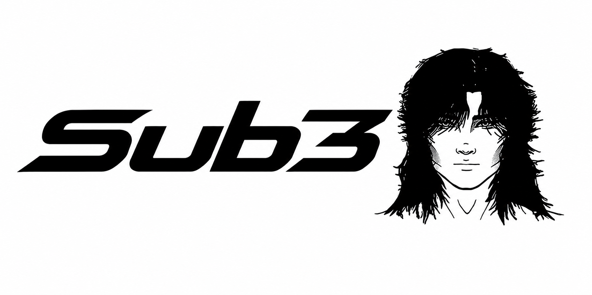

<p align="center"></p>

# Sub3

Розширення для Google Chrome, яке показує під відео два рядки субтитрів: оригінал і переклад. Наведіть курсор на слово, щоб побачити його переклад, синоніми й приклад. Клікніть на слово, щоб отримати детальне пояснення від ШІ разом із перекладом усієї фрази.

Працює на YouTube та сайтах зі звичайним HTML5-плеєром. Для відео без субтитрів (наприклад, Twitch) уміє сам розпізнавати мовлення.

---

## 1. Скачати

1. Відкрийте сторінку **[Releases](../../releases/latest)** цього репозиторію.
2. У розділі **Assets** натисніть **`sub3-extension.zip`**, і файл завантажиться.
3. Розпакуйте архів у папку, яку не будете видаляти, наприклад `Документи/Sub3`.

> Chrome читає розширення прямо з цієї папки. Якщо її видалити або перемістити, Sub3 перестане працювати.

## 2. Встановити

1. Відкрийте в Chrome адресу `chrome://extensions`.
2. Увімкніть **Режим розробника** (Developer mode): перемикач у правому верхньому куті.
3. Натисніть **Завантажити розпаковане** (Load unpacked) і виберіть розпаковану папку — ту, де лежить файл `manifest.json`.
4. Натисніть на іконку пазла праворуч від адресного рядка й закріпіть Sub3 кнопкою-шпилькою.
5. Перезавантажте вкладки з відео, які вже були відкриті.

Якщо Chrome запропонує вимкнути розширення в режимі розробника, просто закрийте це вікно. Так буває з усіма розширеннями, встановленими не з Chrome Web Store.

## 3. Налаштувати

Натисніть іконку Sub3.

- **Субтитри** → виберіть **Мову субтитрів** (якою говорять у відео) і мову, **на яку перекладати**.
- **Переклад** → виберіть **Перекладач**. Для старту підійде **Chrome**: він безкоштовний і не потребує ключа.

## 4. Де взяти ключ (за бажанням)

Ключ потрібен лише для детальних пояснень від ШІ (клік на слово) і для розпізнавання мовлення. Звичайний переклад працює і без нього.

| Сервіс | Де взяти ключ | Для чого |
|---|---|---|
| **Groq** | [console.groq.com/keys](https://console.groq.com/keys) → **Create API Key** | Найшвидший ШІ. Цей самий ключ потрібен для розпізнавання мовлення |
| **Gemini** | [aistudio.google.com/apikey](https://aistudio.google.com/apikey) → **Create API key** | Найкраще пояснює ідіоми й розмовні фрази |
| **DeepL** | [deepl.com/pro-api](https://www.deepl.com/pro-api) → безкоштовний план **API Free** | Природний переклад фраз |

Усі три сервіси мають безкоштовний тариф.

Скопіюйте ключ і вставте його на вкладці **Переклад** у поле «Ключ …». Ключ зберігається лише у вашому браузері й нікуди більше не передається.

## 5. Користуватися

Відкрийте відео з субтитрами. На YouTube увімкніть субтитри (CC) у плеєрі.

| Дія | Що станеться |
|---|---|
| Навести курсор на слово | Переклад слова, синоніми, приклад і переклад фрази. Безкоштовно |
| Клікнути на слово | Детальне пояснення від ШІ з урахуванням контексту і переклад фрази від ШІ |

**Відео без субтитрів:** вставте ключ Groq, відкрийте вкладку з відео, натисніть іконку Sub3 → **Розпізнавати мовлення**. Перший текст з'явиться приблизно через 10–12 секунд.

На YouTube рядок перекладу береться з автоперекладу самого YouTube. Якщо ввімкнути **Готові субтитри YouTube, якщо є**, будуть показуватися субтитри, перекладені людиною. Chrome перекладає лише те, чого немає на YouTube.

## Якщо щось не працює

- **Субтитри Sub3 не з'являються.** Перевірте, що субтитри ввімкнені в плеєрі і що «Мова субтитрів» у Sub3 збігається з мовою субтитрів відео. Перезавантажте сторінку.
- **Netflix, Disney+ та інші платні сервіси.** Вони захищають субтитри, тому Sub3 там зазвичай не працює.
- **«Ліміт … тимчасово вичерпано».** Безкоштовні запити ШІ на сьогодні закінчилися. Звичайний переклад і далі працює, а ШІ відновиться пізніше.
- **«Переклад недоступний» під субтитрами.** У цьому плеєрі не працює вбудований перекладач Chrome. Оновіть Chrome. Пояснення слів по кліку працюватимуть і так.

## Оновлення

Скачайте новий `sub3-extension.zip` зі сторінки [Releases](../../releases/latest) і розпакуйте його в ту саму папку, замінивши файли. Потім у `chrome://extensions` натисніть круглу стрілку на картці Sub3. Налаштування й ключі залишаться.

---

## Для розробників

Потрібен Node.js 20+.

```sh
npm install
npm run build   # перевірка типів і збірка розширення в dist/
npm run test    # тести
```

Після збірки встановіть папку `dist` через **Завантажити розпаковане**. Архів для релізу:

```sh
cd dist && zip -rq ../sub3-extension.zip . && cd ..
```

**Як влаштовано:**
- `src/content/` — пошук субтитрів на сторінці (доріжки YouTube, VTT/SRT, текст плеєра) і показ двох рядків поверх відео.
- `src/background/service-worker.ts` — запити до перекладачів (DeepL, Gemini, Groq, LibreTranslate), ліміти запитів, розпізнавання мовлення.
- `src/translation/` — переклад Chrome і кеш перекладів в IndexedDB.
- `src/popup/` — вікно налаштувань.

Рядок перекладу під субтитрами завжди робить Chrome (або LibreTranslate), тож ліміти не витрачаються. ШІ викликається лише при кліку на слово. Для Gemini 2.5 Flash «міркування» вимкнено (`thinkingBudget: 0`), для Gemini 3+ — `thinkingLevel: "low"`, для Groq gpt-oss — `reasoning_effort: "low"`. Одночасно йде не більше двох запитів на провайдера, а після помилки 429 провайдер робить паузу на час із `Retry-After`.

**Локальні сервери (необов'язково):**

- LibreTranslate на порту 5050: `npm run translator` (потрібне віртуальне середовище `.venv-libretranslate`).
- MLX Whisper для розпізнавання мовлення на Mac з Apple Silicon:

  ```sh
  uv venv --python 3.12 .venv-mlx
  uv pip install --python .venv-mlx/bin/python -r requirements-mlx.txt
  npm run mlx-whisper
  ```

Тестова сторінка з відео й субтитрами: `npm run demo` → `http://127.0.0.1:5173/demo.html`.
